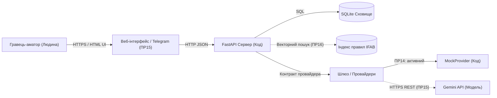

# Архітектура системи (ПР14)

## 1. Рівень контексту та контейнерів

* **Людина**: вводить запит у довільній формі та контролює безпеку виконання вправи на полі.
* **Код (ПР14)**: прийом HTTP, валідація меж (Pydantic), оркестрація, шлюз, підставний провайдер, збереження історії в SQLite, JSON-журнал.
* **Модель / RAG (ПР15–ПР16)**: підключення реального Gemini API та векторного індексу правил IFAB (місце зарезервоване в `orchestration.py` та `/api/health`).

---

## 2. Шари сервера (`app/`)

| Файл / Модуль | Шар | Обов'язок |
| :--- | :--- | :--- |
| `app/main.py` | Контролер + UI | Маршрути HTTP, веб-сторінка `/`, `/api/health`, єдиний формат помилок, `request_id`. |
| `app/service.py` | Прикладний сервіс | Сценарій запиту, координація оркестрації та сховища без прив'язки до HTTP. |
| `app/orchestration.py` | Оркестрація AI | Формування промпту та схеми виходу, парсинг JSON-відповіді моделі, резерв під RAG (ПР16). |
| `app/gateway.py` | Шлюз LLM | Вибір провайдера за конфігурацією, облік токенів/вартості та контроль помилок. |
| `app/providers/` | Абстракція провайдера | Єдиний контракт `BaseProvider`, детермінований `MockProvider` зі збоями та заготовка `NotImplementedProvider`. |
| `app/storage.py` | Сховище даних | Абстракція `BaseStorage` і реалізація `SQLiteStorage` зі створенням схеми кодом. |
| `app/models.py` | Моделі даних | Контракти входу, виходу, помилок, провайдера та БД із валідацією на межах. |
| `app/settings.py` | Конфігурація | Одноразове читання `.env` із перевіркою ключів на старті. |
| `app/telemetry.py` | Журнал (Telemetry) | Запис подій усіх шарів у JSON-форматі з єдиним `request_id` без секретів. |
